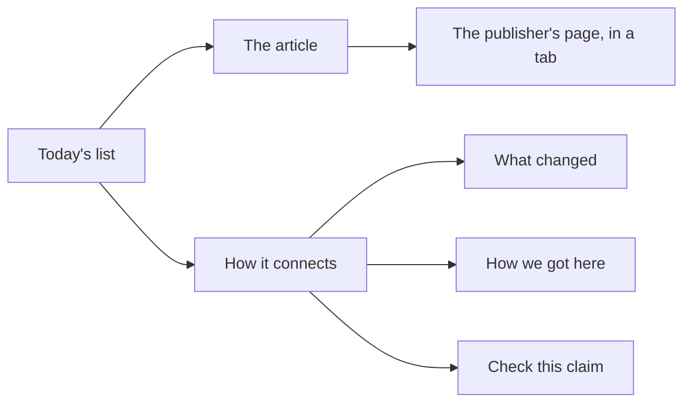
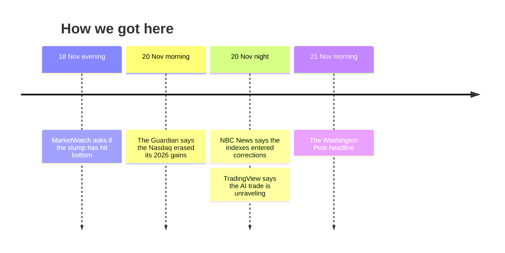
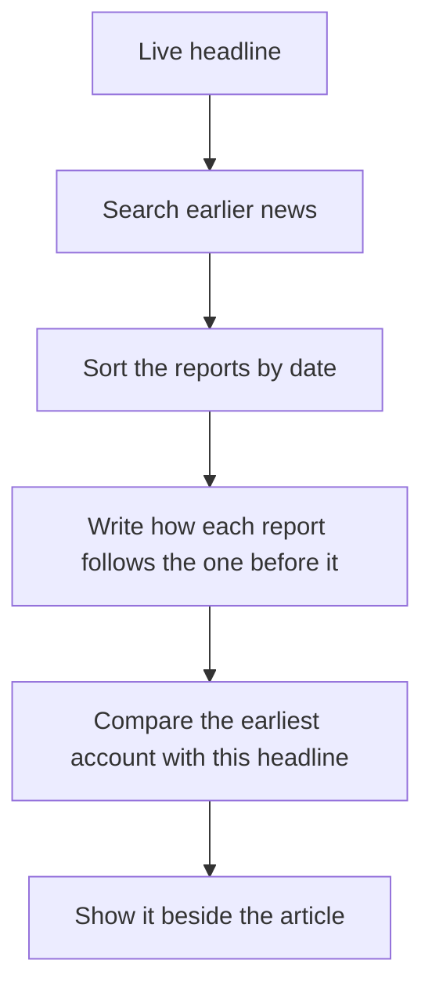

# The Paper Trail

The Paper Trail is a news reader that keeps the article and the record behind it on the same page.

You open today’s list, read the publisher’s own page, then switch to **How it connects**. That view answers two questions:

- Did this headline say what the earlier reports said?
- What was published, in order, between the oldest report and this one?

Built for the *Hack with Sang* hackathon.

## How a story opens



**Today’s list** is the front door. Each row is a headline, with when it ran, who published it, and a short status. Catalog stories are already traced. Live headlines are traced as they come in. Search filters the list.

**The article** loads the publisher’s page inside the app, in a small browser tab: site name, address, and the page itself. The app does not rewrite the piece into its own words. Some publishers refuse to be shown inside another site, so that tab can stay blank even though the address is the real article.

**How it connects** is the paper trail.

| Section | What it shows |
|---|---|
| The telling changed | The earlier account beside this headline, and the part that no longer matches |
| How we got here | The reports in time order, oldest first, down to this headline. Each “Then” says how the next report follows |
| Check this claim | A check of the headline against other reporting, with sources |

Close the story with the **×** at the top.

## Example

Headline, *The Washington Post*, 21 November 2026, 6:26 AM UTC:

> U.S. stocks slump into correction territory amid tech and AI worries

The earliest report in the trail does not say that. On 18 November, MarketWatch asked whether the slump had already hit bottom. The later headline drops the question and states that the market is in a correction.



**What changed.** The subject is the status of the decline. MarketWatch left it open. The Post headline treats the correction as the fact.

**Then.** The Guardian report is the point where the year’s gains are described as gone. NBC and TradingView follow that night, from a plunge in the indexes to the AI trade coming apart. The Post headline the next morning is the end of that trail.

That is one reading. A live trace looks for earlier reports, sorts them by publication time, and writes the “Then” lines from one report to the next. Dates that cannot be read stay in the order the record was assembled.

## How a live headline is traced



Curated stories ship with their trail already built, so the demo does not depend on a live search.

## Stack

| Layer | Tech |
|---|---|
| Backend | FastAPI, Pydantic v2, httpx, uvicorn |
| Frontend | React 18, TypeScript, Vite, Tailwind CSS |
| News search | SerpApi |
| Writing the trail | Gemini |

## Getting started

### 1. Configure keys

```bash
cp .env.example .env
```

Fill in `SERP_API_KEY` and `GEMINI_API_KEY`. The app boots without them. Live headlines and claim checks need the keys. `YOU_COM_API_KEY` is used when a claim is checked against other sources.

### 2. Backend

```bash
cd backend
python3 -m venv venv
source venv/bin/activate
pip install -r requirements.txt
uvicorn app.main:app --reload --port 8000
```

Runs at `http://127.0.0.1:8000`. API docs at `/docs`.

### 3. Frontend

```bash
cd frontend
npm install
npm run dev
```

Runs at `http://127.0.0.1:5173`.

## API

| Method | Path | Purpose |
|---|---|---|
| `GET` | `/api/health` | Health check |
| `GET` | `/api/story/trending?q=` | Today’s headlines |
| `GET` | `/api/story/catalog` | Curated stories |
| `GET` | `/api/story/flagship?story_id=` | One curated story, with its trail |
| `POST` | `/api/story/analyze` | Build the trail for a live headline |
| `POST` | `/api/story/drill-deeper` | Look further back from the oldest report |
| `POST` | `/api/interrogate` | Check a claim |

## Project layout

```
backend/
  app/
    main.py            FastAPI app
    routers/           story and claim-check endpoints
    services/          news search and the writing of the trail
    models/schemas.py  story graph and verdict shapes
    data/              curated stories
frontend/
  src/
    components/        list, article tab, what changed, history, claim check
    reading/           turns a story graph into the words on the page
    api/client.ts      backend client
```

## Notes

- The backend reads `.env` from the repository root.
- CORS allows every origin, for local development.
- Do not commit `.env`. It is gitignored. `.env.example` is the tracked copy.
